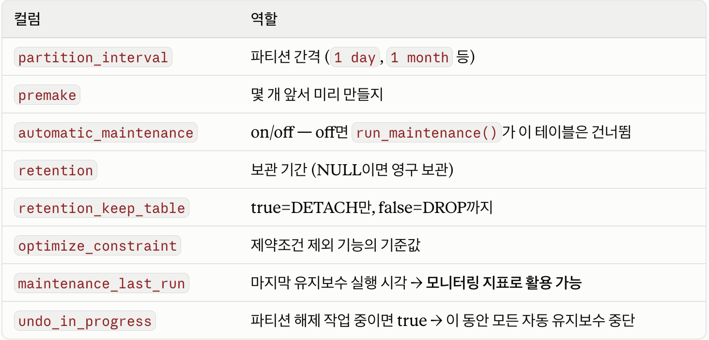

# 3주차 PG

## week2 질문

- HypoPG가 실제로 어떤 hook에, 어떤 코드로 가상 인덱스를 붙이는지

```bash
[사용자가 함수 호출]
SELECT hypopg_create_index('CREATE INDEX ON hypo (id)');
        ↓
① SQL 문자열을 파싱해서 "entry"(가짜 인덱스 정보 덩어리)를 하나 생성
② entry에 번호표(OID)와 이름표(name)를 붙여서 세션 메모리 리스트(entries)에 저장
   ※ 여기까지는 디스크에 아무것도 안 씀. 그냥 메모리에 저장만 함.

[나중에 사용자가 EXPLAIN 실행]
EXPLAIN SELECT val FROM hypo WHERE id = 1;
        ↓
③ 플래너가 hypo 테이블의 인덱스 목록을 확인하는 지점(hook)을 지남
        ↓
④ HypoPG 함수(hypo_get_relation_info_hook)가 자동 실행됨
   → entries 리스트를 뒤져서 지금 테이블(hypo)과 일치하는 entry를 찾음
        ↓
⑤ hypo_injectHypotheticalIndex() 호출
   → entry 내용을 베껴서 IndexOptInfo(플래너가 읽는 공식 양식)로 내용을 그대로 적음
   → rel->indexlist 리스트에 추가
	   rel: 지금 다루고 있는 테이블에 대한 정보를 담는 곳
        ↓
⑥ 플래너는 이 리스트만 보고 "인덱스가 있네" 하고 비용 계산에 반영
```

참고)

```bash
SELECT hypopg_create_index('CREATE INDEX ON hypo (id)');
       └──────┬──────┘      └───────────┬──────────┘
        HypoPG가 제공하는          진짜로 실행되는 SQL이 아니라
        함수 (진짜 실행됨)         함수에 넘겨지는 "텍스트"일 뿐

즉, hypoPG의 함수가 실행되고, 파라미터가 값을 받아서 해석만 함
```

- 코드

```c
// ① SQL을 파싱해서 entry 생성 (hypopg_create_index 함수 안)
entry = hypo_newIndex(...);
entry->oid  = hypo_getNewOid();      // 번호표
entry->name = "btree_hypo_id";       // 이름표
entries = lappend(entries, entry);   // 메모리 리스트에 저장

// ③④ EXPLAIN 시점에 훅에 걸림
static void hypo_get_relation_info_hook(PlannerInfo *root,
                                         Oid relationObjectId,
                                         bool inhparent,
                                         RelOptInfo *rel)
{
    foreach(lc, entries) {
        hypoEntry *entry = lfirst(lc);
        if (entry->relid == relationObjectId)
            hypo_injectHypotheticalIndex(root, relationObjectId,
                                          inhparent, rel, relation, entry);
    }
}

// ⑤ 가짜 스펙시트를 만들어서 리스트에 끼워넣음
void hypo_injectHypotheticalIndex(...)
{
    IndexOptInfo *index = makeNode(IndexOptInfo);
    index->indexoid = entry->oid;     // entry의 번호표를 그대로 복사
    // ... 컬럼, 타입 등도 entry에서 복사 ...

    rel->indexlist = lappend(rel->indexlist, index);  // ← 여기가 "부착" 순간
}
```

### entry

메모리에서 가상 인덱스 한 개를 표현함

즉, 엔트리 자체가 가상 인덱스인 거임

```bash
entry (hypoIndex 구조체) 하나 = 사람으로 치면 "신분증"

entry 안에 들어있는 정보:
├─ oid        → 임시 번호표 (18284)
├─ name       → 이름표 (btree_hypo_id)
├─ relid      → 어느 테이블에 대한 인덱스인지 (hypo 테이블)
├─ ncolumns   → 몇 개 컬럼에 거는지 (id 컬럼 1개)
├─ relam      → 어떤 방식인지 (btree, hash...)
└─ (기타 정렬 방식, 연산자군 등)
```

- hypopg_create_index()를 한 번 실행할 때마다 entry가 1개씩 새로 만들어짐

### 인덱스에 가상의 인덱스 (임시 이름표 OID) 왜 쓰는지?

- 여러개의 가상 인덱스(엔트리)를 구분하기 위해서
  - 실제 OID를 발급받아쓰면 카탈로그에 write 작업 필요
  - lock 관리
  - WAL 기록 필요

```bash
entries 리스트 (세션 메모리)
├─ entry 1  { oid: 18284, name: "btree_hypo_id",  relid: hypo }
├─ entry 2  { oid: 18290, name: "btree_hypo_id",  relid: hypo }   ← 이름 같을수도 있음
└─ entry 3  { oid: 18295, name: "hash_hypo_val",  relid: hypo }
```

---

파티셔닝

- 테이블 하나를 물리적으로 여러 개의 작은 테이블(파티션)으로 쪼개는 것
  - 조회 속도 증가
  - DROP시 행 단위 DELETE 대신 테이블 단위 DROP으로 처리
  - 파티션 단위로 관리하기 좋아짐
    - 파티션 단위로 통째로 다른 스키마나 저장소로 옮김
    - 덤프해서 별도 보관하기 쉬워짐
    - 즉, 큰 테이블에서 일부 row만 추출해서 옮기는 것보다 간단해짐
    - VACUUM 작업이 상대적으로 가벼워짐 (원본을 바로 지우지 않고 tombstone처럼 표시를 남기는데, 이후에 이 표시를 지우는 작업을 말함)

## pg_partman

- 관리 도구
  - 소스 코드 레벨의 hook이 아니라, “함수 호출 + 설정 테이블 + 백그라운드 워커”로 이루어진 관리 도구

- PG는 선언적 파티셔닝을 지원은 함

```bash
PARTITION BY RANGE(칼럼)
```

테이블은 쪼갤 수 있지만, 테이블을 쪼개는 그 기능 밖에 없음

운영을 자동화 해주지는 않음

pg_partman이 이를 보충해줌

```bash
① 자동 생성  : 시간이 지나면 알아서 새 파티션(자식 테이블)을 미리 만들어둠
② 자동 삭제  : 보관 기간(retention)이 지난 오래된 파티션을 알아서 정리
③ 속성 상속  : PostgreSQL 코어가 못 물려주는 속성(PK, unique index 등)을
              템플릿 테이블을 통해 자식들에게 물려줌
```

pg_partman은 **“템플릿 테이블”**이라고 불리는 테이블을 하나 더 만들어서 코어가 못 물려주는 속성을 이 템블릿 대신 복사해서 가져옴

이때 템플릿 테이블 속성은 소급 적용이 안됨

즉, 템플릿을 나중에 변경해도 이미 만들어진 자식 테이블에는 반영이 안되고, 앞으로 새로 만드는 자식 테이블에게만 적용됨

참고로, 시간이 지날수록 코어에 해당 속성들이 추가될 수도 있기에 임시방편이긴함

1. **파티션 세트 생성**

```sql
-- 1단계: 부모 테이블을 먼저 "선언적 파티션"으로 만들어둬야 함
CREATE TABLE public.messages (
  id bigint GENERATED BY DEFAULT AS IDENTITY,
  sent_at timestamptz NOT NULL,
  body text,
  PRIMARY KEY (sent_at, id)
) PARTITION BY RANGE (sent_at);

-- 2단계: pg_partman에게 이 테이블을 맡김
SELECT partman.create_parent(
    p_parent_table := 'public.messages',
    p_control      := 'sent_at',
    p_interval     := '1 day'
);
```

- create_partition()

```sql
create_partition(
    p_parent_table text
    , p_control text
    , p_interval text
    , p_type text DEFAULT 'range'
    , p_epoch text DEFAULT 'none'
    , p_premake int DEFAULT 4
    , p_start_partition text DEFAULT NULL
    , p_default_table boolean DEFAULT true
    , p_automatic_maintenance text DEFAULT 'on'
    , ...
)
```

- `p_parent_table`은 이 함수 실행 중 **ACCESS EXCLUSIVE 락**을 겁니다. 다만 데이터를 옮기진 않으니 락 자체는 짧게 끝납니다.
  - ACCESS EZCLUSIVE LOCK: 테이블의 구조 자체를 바꿀때 사용하는 최상위 lock
  - 파티션 구성 정보 업데이트나, 테이블 정의를 바꿀 때 사용하는 lock
- `p_premake` (기본값 4) = "현재 파티션보다 몇 개 앞서서 미리 만들어둘지". 오늘이 9/6이고 daily면, 9/6~9/10까지 5개가 미리 만들어짐.
- `p_default_table` = true가 기본. 경계에 안 맞는 데이터가 들어와도 에러 없이 일단 여기로 받아둠

2. **자동 유지보수 - 실제 파티션이 새로 생기는 지점**

```sql
run_maintenance_proc(
    p_wait int DEFAULT 0
    , p_analyze boolean DEFAULT NULL
    , p_jobmon boolean DEFAULT true
)
```

실질적으로 새 파티션으로 만들고, 오래된 걸 지우는 실행 함수

이걸 누가 언제 불러주느냐가 핵심

- pg_partman 자체 백그라운드 워커(BGW)
  ```bash
  # postgresql.conf
  shared_preload_libraries = 'pg_partman_bgw'   # 재시작 필요!
  pg_partman_bgw.dbname = 'mydb'
  pg_partman_bgw.role = 'partman_maintainer'
  pg_partman_bgw.interval = 3600    # 1시간마다
  ```

  > run_maintenance_proc()를 대신 호출해주는 스케줄러일 뿐, 특별한 로직은 없음
- pg_cron으로 외부 스케줄링
  ```sql
  CREATE EXTENSION IF NOT EXISTS pg_cron;
  SELECT cron.schedule('@hourly', $$CALL partman.run_maintenance_proc()$$);
  ```

  > run_maintenace_proc(): 프로시져를 쓰는 이유: 파티션셋 하나 끝날 때마다 커밋을 진행
  > 한번에 모든 파티션셋 처리하면 트랜잭션이 길어져 lock 경합이 발생하기 쉬워짐

새 파티션은 현재 파티션보다 premake 값보다 적을 때만 새로 만듦

즉, run_maintenance()를 자주 불러도 필요 이상으로 파티션을 만들지 않음

3. **보관 정책(retention) - 자동 삭제**

```sql
part_config 테이블의 retention 컬럼에 값 하나만 넣으면 끝

UPDATE partman.part_config
SET retention = '3 months'
WHERE parent_table = 'public.messages';
```

- 시간 기반: `retention = '1 month'`이면, 데이터가 전부 1개월보다 오래된 파티션은 `run_maintenance()` 실행 시 자동 처리
- ID 기반: 현재 최대 ID(정수값)에서 retention 값을 뺀 것보다 작은 ID만 있는 파티션 삭제
- 기본은 **DROP이 아니라 DETACH** (`retention_keep_table = true`가 기본값). 완전 삭제하려면 `retention_keep_table = false`로 명시해야 함

- part_confing: 핵심 설정 테이블
  - 모든 자동화 동작이 해당 테이블의 값을 보고 결정됨



4. **Default 파티션 - 안전장치**

```sql
check_default(
    p_exact_count boolean DEFAULT true
    , p_ignore_infinity boolean DEFAULT false
)
```

기존 데이터의 경계값이 아직 준비되지 않은 파티션에 들어오면 에러를 내거나 데이터를 버리는 대신, **모든 파티션셋에 자동으로 "default" 테이블**을 하나 만들어서 일단 거기로 받아둡니다.

미래 파티션 생성 여부는 **default 테이블 안의 데이터는 무시하고** 기존 파티션셋 데이터만 기준으로 판단함

그래서 `premake` 값을 넉넉히 잡아두는 게 권장됨

5. **서브파티셔닝**

파티션 안에 파티션을 한 번 더 만든 것

즉, 자식을 또 가지는 것

```sql
logs (최상위 부모)
├─ logs_2024 (연도 파티션, 동시에 2단계의 부모)
│    ├─ logs_2024_01
│    ├─ logs_2024_02
│    └─ ...
├─ logs_2025
│    ├─ logs_2025_01
│    └─ ...
└─ logs_2026
     ├─ logs_2026_01
     └─ ...
```

```sql
create_sub_partition(
    p_top_parent text
    , p_control text
    , p_interval text
    , p_declarative_check text  -- "yes" 명시해야 진행됨
    ...
)
```

서브파티셔닝은 매우 제한적으로만 유용하며, 극단적으로 큰 데이터(수백TB ~ PB급) 아니면 성능상 이득이 없다고 함

- 이미 파티션이 된 상태면 해당 파티션만 보고, 거기서 또 파티션된걸 보면 스캔량이 줄어들지가 않음

또한 기존 파티션셋을 서브파티션으로 바꾸는 작업은 자식 테이블을 지웠다가 다시 만들어야해서 파괴적인 작업임

- 서브파티셔닝 주로 사용할때: **데이터 조직화와 보관 정책 관리**

파티셔닝을 왜하는지

파티셔닝 premake 여유분 왜 필요한지?

