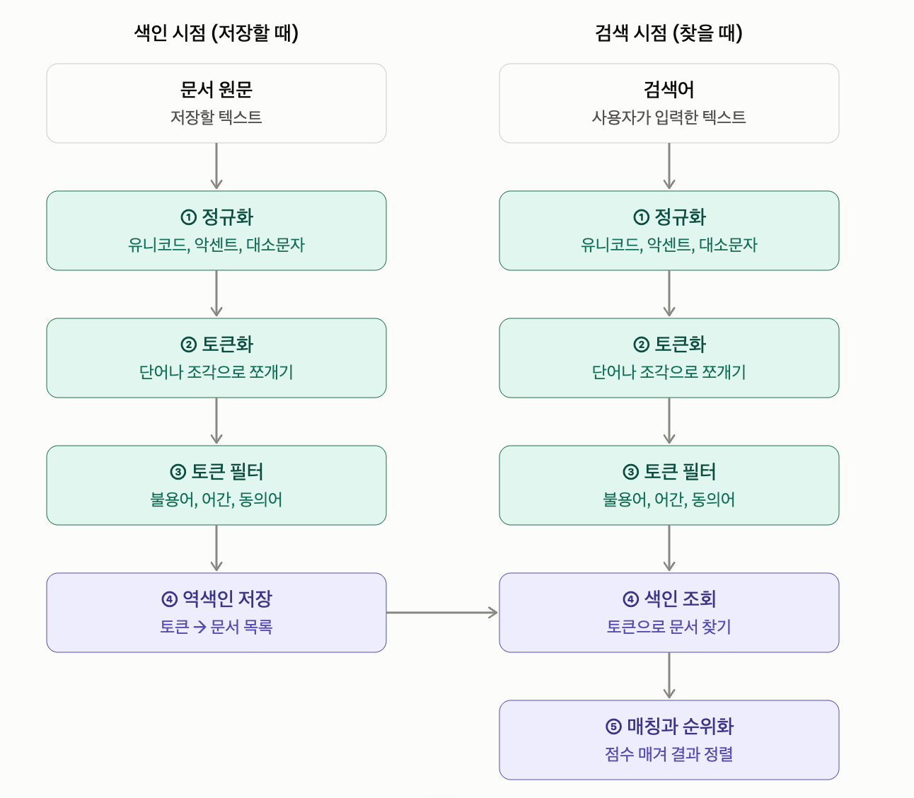
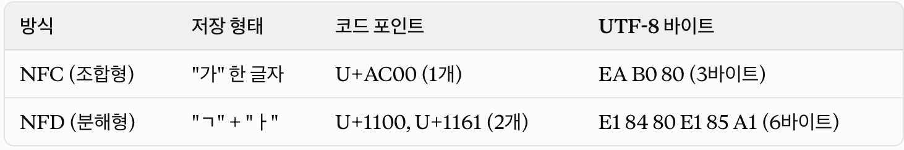
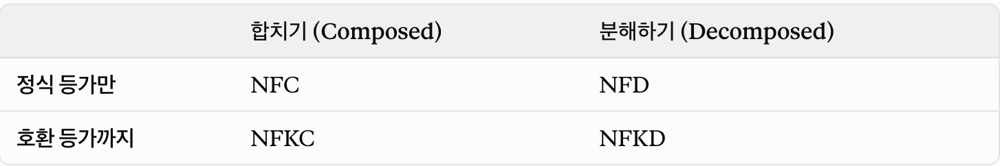
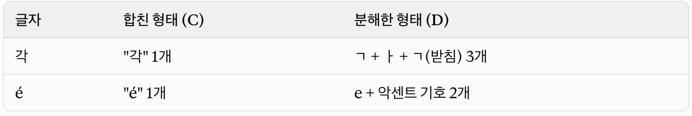
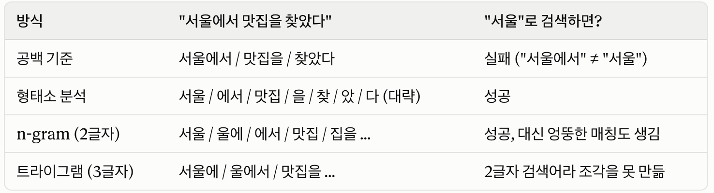
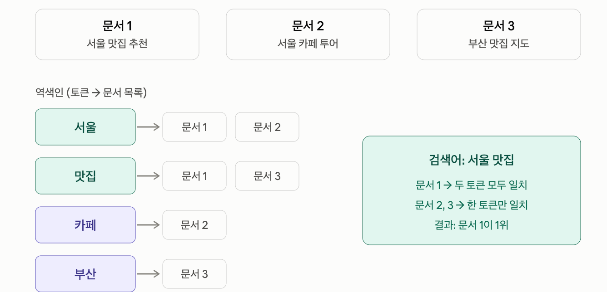

# 4주차 PG

#### 파티셔닝을 왜 하는가

파티셔닝은 **하나의 큰 테이블을 논리적으로는 하나처럼 보이게 두면서, 물리적으로는 여러 개의 작은 테이블(파티션)로 쪼개 저장하는 것**입니다. 예를 들어 `orders` 테이블을 월별로 나누면 `orders_p2026_08`, `orders_p2026_09` 같은 실제 테이블이 생기고, 애플리케이션은 여전히 `orders`에만 쿼리합니다.

##### 1. 오래된 데이터를 저렴하게 지운다 (가장 큰 이유)

로그, 이벤트, 주문 이력처럼 "90일 지나면 삭제" 같은 보관 정책이 있는 데이터를 생각해 보세요.

파티션이 없으면 `DELETE FROM events WHERE created_at < now() - interval '90 days'`를 돌려야 합니다. 이 방식에는 문제가 많습니다. 수천만 행을 하나하나 지우면서 WAL이 대량으로 쌓이고, 지운 행은 바로 사라지지 않고 dead tuple로 남아 테이블과 인덱스가 부풀고, 그걸 VACUUM이 치우느라 또 부하가 생깁니다.

파티션이 있으면 `DROP TABLE events_p2026_06;` 한 줄로 끝납니다. 파일을 통째로 버리는 것이라 거의 즉시 끝납니다. 보관이 필요하면 `DETACH PARTITION`으로 떼어 내서 따로 백업하거나 옮길 수도 있습니다.

##### 2. 필요한 파티션만 읽는다 (파티션 프루닝)

`WHERE created_at >= '2026-09-01'`처럼 파티션 키로 조건을 걸면, 플래너가 해당 범위의 파티션만 읽고 나머지는 아예 건너뜁니다. 이를 파티션 프루닝이라고 합니다. 최근 데이터만 자주 조회하는 서비스라면 스캔 범위가 크게 줄어듭니다.

- 파티션키: **테이블을 만들 때 "무엇을 기준으로 쪼갤지" 정한 컬럼**을 말함

```sql
CREATE TABLE events (
    id          bigint,
    user_id     bigint,
    created_at  timestamptz NOT NULL,
    payload     jsonb
) PARTITION BY RANGE (created_at);   -- ← created_at이 파티션 키
```

각 파티션은 키의 범위를 나눠 가지게 됨

```sql
CREATE TABLE events_p2026_08 PARTITION OF events
    FOR VALUES FROM ('2026-08-01') TO ('2026-09-01');
CREATE TABLE events_p2026_09 PARTITION OF events
    FOR VALUES FROM ('2026-09-01') TO ('2026-10-01');
```

파티션별로 관리를 하기에 유지보수 단위 또한 작아지게 된다.

##### 3. 자주 쓰는 데이터가 메모리에 잘 올라간다

최근 파티션의 테이블과 인덱스는 전체보다 훨씬 작아서 shared buffers나 OS 캐시에 올라가기 쉽습니다. 오래된 데이터 때문에 캐시가 밀려나는 일이 줄어듭니다.

##### 파티셔닝이 손실이 되는 경우

- **파티션 키 없이 조회하는 쿼리가 많으면** 모든 파티션을 다 뒤져야 해서 오히려 느려질 수 있습니다.
  - ex) 날짜로 나눴는데 `WHERE customer_id = 123`만으로 자주 찾는 경우입니다.
- **파티션 수가 너무 많으면** 플래너가 계획을 세우는 비용이 늘어납니다.
  - **리마인드)** 플래너: 쿼리 실행 계획을 세우는 부분

  1. **파서:** SQL 문법을 해석
  2. **플래너(옵티마이저라고도 함):** "이 쿼리를 어떻게 실행하는 게 가장 빠를까?"를 결정하고, 인덱스를 쓸지, 테이블 전체를 읽을지, 조인 순서는 어떻게 할지 등을 결정
  3. **실행기(Executor):** 플래너가 세운 계획대로 실제로 데이터를 읽음
- **PK와 UNIQUE 제약에 파티션 키가 포함되어야 합니다.** `order_id` 단독 PK를 만들 수 없고 `(order_id, order_date)`가 되어야 합니다.
  - 즉, 파티션마다 중복되는 키가 존재할 수 있기때문
- **테이블이 작으면** 얻는 것 없이 복잡도만 늘어납니다. 보통 수천만 행 이상이거나, 보관 정책에 따른 삭제가 필요할 때 검토합니다.

#### premake란

- premake는 "현재 파티션보다 앞서서 미래 파티션을 몇 개 만들어 둘지"입니다. pg_partman의 기본값은 현재 활성 파티션보다 4개 앞까지 만들어 두는 것입니다.

예를 들어 일 단위 파티션에 premake가 4이고 오늘이 9월 23일이면, 9월 23일 파티션에 더해 24, 25, 26, 27일 파티션이 이미 존재하는 상태를 유지합니다. 매일 유지보수가 돌면서 28일 파티션을 새로 만들고, 이렇게 "앞쪽 여유분"이 항상 4개로 유지됩니다.

#### premake 여유분이 왜 필요한가

핵심 질문은 이겁니다. **"파티션을 딱 필요한 시점에 만들면 안 되나?"** 안 되는 이유는, 들어갈 파티션이 없는 순간 문제가 터지기 때문입니다.

##### 들어갈 파티션이 없으면 벌어지는 일

**기본(default) 파티션이 없는 경우:** 해당 범위의 파티션이 없으면 INSERT가 에러로 실패합니다(`no partition of relation ... found for row`). 즉, 자정에 새 날짜 데이터가 들어오는데 그날 파티션이 없으면, 그 순간부터 모든 쓰기가 실패합니다.

**기본 파티션이 있는 경우:**  (**하나의 행은 반드시 딱 한 파티션에만 속해야 한다.)**

그래서 새 파티션을 만들 때 PostgreSQL은 기본 파티션 안에 새 파티션 범위에 해당하는 행이 이미 있나?"를 검사합니다. 만약 있으면, 그 행이 기본 파티션과 새 파티션 양쪽에 속하게 되는 모순이 생기니까 **새 파티션 생성을 거부**합니다.

```sql
ERROR: updated partition constraint for default partition would be violated by some row
```

이 경우 default 파티션의 데이터를 올바른 파티션으로 옮기는 수작업(pg_partman의 `partition_data_proc` 등)이 필요하고, 그동안 default 파티션은 계속 커집니다. 그래서 **default 파티션에 행이 쌓이기 시작하면 이미 사고가 난 것**으로 보고 모니터링해야 합니다.

##### 여유분이 해결하는 것: "유지보수가 실패해도 버틸 시간"

---

## 검색 파이프라인



##### 1. 정규화: 표기 차이 없애기

글자 수준에서 "같은 것인데 다르게 적힌 것"을 통일합니다.

- **유니코드 정규화:** 눈에는 같아 보여도 바이트가 다른 문자를 통일합니다. 한글이 자모 분리 형태(NFD)로 들어온 경우를 NFC로 합치거나, 전각 "ＡＢＣ"를 반각 "ABC"로 바꾸는 것(NFKC)이 대표적입니다.
  - 한글의 NFC와 NFD
    - 유니코드에는 한글 "가"를 표현하는 방법이 두 가지 있습니다.

    

    - 저장된 값 자체가 다르니 DB는 둘을 다른 문자열로 봅니다.

    ```sql
    SELECT '가' = U&'\1100\1161';                    -- false (눈에는 둘 다 "가")
    SELECT length('가'), length(U&'\1100\1161');     -- 1, 2
    SELECT '가' = normalize(U&'\1100\1161', NFC);    -- true (정규화 후 같아짐)
    ```

    - 가장 흔한 곳은 macOS, macOS에서는 파일명을 NFD로 저장하는 경우가 많아서, 맥에서 업로드한 "보고서.pdf"라는 파일명이 DB에 NFD로 들어갑니다. 그러면 사용자가 "보고서"로 검색해도 결과가 나오지 않습니다. 윈도우에서 받은 맥 파일명의 자모가 "ㅂㅗㄱㅗㅅㅓ"처럼 풀려 보이는 현상도 같은 원인입니다.
- **악센트 제거:** "Café" → "Cafe". unaccent가 하는 일
- **대소문자 통일:** "GREAT" → "great".

- 전각은 "칸 전체", 반각은 "칸의 절반 (원고지를 생각하면 됨)

### 정규화 방식



- **NFC:** 합치기만 합니다. 전각이나 원문자는 건드리지 않습니다.
  - 웹 문서와 대부분의 시스템이 NFC를 씁니다. DB에 저장할 때 "원문을 보존하면서 표기만 통일"하려면 NFC가 기본 선택입니다.
- **NFD:** 쪼개기만 합니다. 역시 전각이나 원문자는 그대로입니다.
  - macOS 파일명에서 흔히 나타나는 형태입니다. 일부러 쓰는 경우도 있는데, **글자를 부품으로 쪼개야 할 때** 유용합니다. 예를 들어 "é"를 NFD로 쪼갠 뒤 악센트 부품만 지우면 "e"가 되는데, 이게 악센트 제거의 기본 원리입니다.
- **NFKC:** 호환 문자를 기본 문자로 바꾼 뒤 합칩니다. 전각 → 반각, ① → 1, ㈜ → (주).
  - 검색용 정규화에 가장 많이 씁니다. 전각 영숫자, 원문자, 단위 기호까지 통일되니 "보이는 뜻대로 검색되게" 하는 데 적합합니다.
- **NFKD:** 호환 문자를 바꾼 뒤 쪼갭니다. 그래서 ㈜가 "(주)"를 거쳐 "(ㅈ+ㅜ)"까지 분해됩니다.
  - 가장 공격적인 정규화입니다. 호환 문자도 바꾸고 모든 글자도 쪼갭니다. 전각도 통일하고 악센트도 떼고 싶은 검색 시스템에서 중간 단계로 쓰는 경우가 있지만, 직접 쓸 일은 드뭅니다.

- **가로축 (C vs D):** 글자를 합친 상태로 둘까, 쪼갠 상태로 둘까?



- **세로축 (K 없음 vs K 있음):** "완전히 같은 글자"만 통일할까, "모양만 다르고 뜻이 같은 글자"까지 통일할까?

**정식 등가**는 "완전히 같은 글자인데 저장 방식만 다른 것"입니다. 위의 "각"과 "ㄱ+ㅏ+ㄱ"이 그렇습니다. 누가 봐도 같은 글자입니다.

**호환 등가**는 "모양이나 쓰임새는 다르지만 뜻은 같다고 볼 수 있는 것"입니다. 전각 "Ａ"와 반각 "A", 원문자 "①"과 숫자 "1"이 그렇습니다. 같은 뜻이지만 엄밀히는 다른 글자입니다.

- PostgreSQL 13부터 내장 함수가 있습니다. DB 인코딩이 UTF-8이어야 동작합니다.

```sql
SELECT normalize('ＡＢＣ１２３', NFKC);           -- ABC123
SELECT U&'\1100\1161' IS NFC NORMALIZED;         -- false (NFD 상태라는 뜻)

-- 이미 들어간 NFD 데이터 찾기
SELECT id, name FROM files WHERE name IS NOT NFC NORMALIZED;
```

##### ② 토큰화: 검색 단위로 쪼개기

파이프라인에서 **가장 중요한 결정**입니다. 무엇을 "한 단위"로 볼지에 따라 검색 결과가 완전히 달라집니다.



영어는 띄어쓰기가 곧 단어 경계라서 공백 기준으로도 꽤 잘 되지만, 한국어는 조사와 어미가 붙기 때문에 **형태소 분석이나 n-gram이 필요**합니다. 한국어 검색이 어려운 이유의 대부분이 이 단계에 있습니다.

##### ③ 토큰 필터: 토큰을 다듬기

쪼갠 토큰을 한 번 더 가공합니다.

- **불용어 제거:** 검색에 의미 없는 토큰을 버립니다. 영어의 "in", "the", 한국어의 조사 "에서", "을" 같은 것들입니다.
- **어간 추출(stemming):** 변형된 단어를 기본형으로 돌립니다. "cafes" → "cafe", "running" → "run".
- **동의어 확장:** "휴대폰"을 "핸드폰", "스마트폰"과 같은 것으로 취급합니다.

##### ④ 역색인: 토큰에서 문서를 거꾸로 찾는 구조

검색 엔진의 핵심 자료구조입니다. 문서마다 어떤 단어가 있는지 적는 대신, **단어마다 그 단어가 나오는 문서 목록**을 적어 둡니다.



- 역색인이 빠른 이유는 **문서를 하나씩 열어 보지 않기 때문**입니다.
  - 검색어를 토큰으로 바꾼 뒤 해당 토큰의 목록만 꺼내서 겹치는 문서를 찾으면 끝납니다.
  - 문서가 1억 개여도 "서울" 목록과 "맛집" 목록만 읽으면 됩니다.
  - `LIKE '%서울%'`이 느린 이유는 반대로 모든 행을 열어서 문자열을 훑어야 하기 때문입니다.

cf) PostgreSQL의 **GIN 인덱스가 바로 이 역색인 구조**입니다. GIN(Generalized Inverted Index)이라는 이름 자체가 "범용 역색인"이라는 뜻입니다. 그래서 FTS의 tsvector에도, pg_trgm의 트라이그램에도 GIN을 씁니다. 토큰이 단어냐 3글자 조각이냐만 다를 뿐 구조는 같습니다.

##### ⑤ 매칭과 순위화: 무엇을 먼저 보여 줄까

찾은 문서에 점수를 매겨 정렬합니다. 여기서 도구마다 차이가 큽니다.

- **단순 일치:** 토큰이 있으면 결과에 포함, 없으면 제외. 순서는 따로 정해야 합니다.
- **유사도:** pg_trgm의 `similarity()`처럼 "얼마나 비슷한가"를 0~1로 계산합니다. 오타 허용에 강합니다.
- **BM25:** 전문 검색 엔진의 표준 점수 방식입니다. 세 가지를 따집니다.
  - 검색어가 문서에 **많이 나올수록**(단, 너무 많으면 효과가 줄어듦)
  - 검색어가 **드문 단어일수록**(모든 문서에 나오는 "서울"보다 몇 개 문서에만 나오는 "을지로"가 더 결정적)
  - 문서가 **짧을수록**(같은 횟수라면 짧은 글에서의 등장이 더 의미 있음) 점수가 높아집니다. 앞에서 본 pg_search의 `k1`과 `b` 파라미터가 각각 반복 횟수 효과와 문서 길이 효과를 조절합니다.

