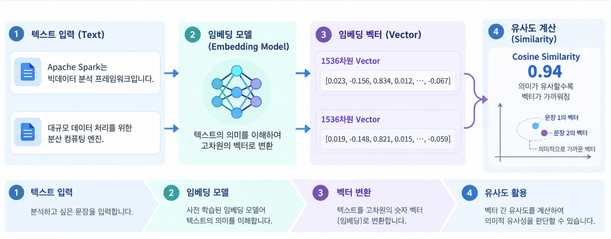
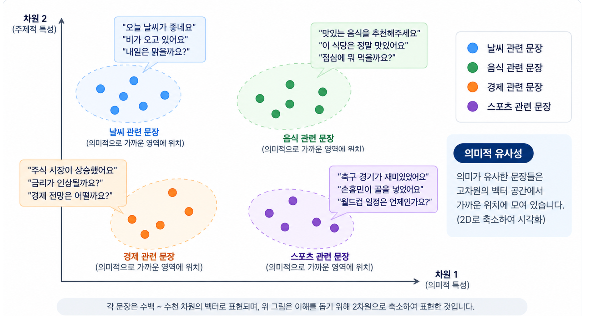
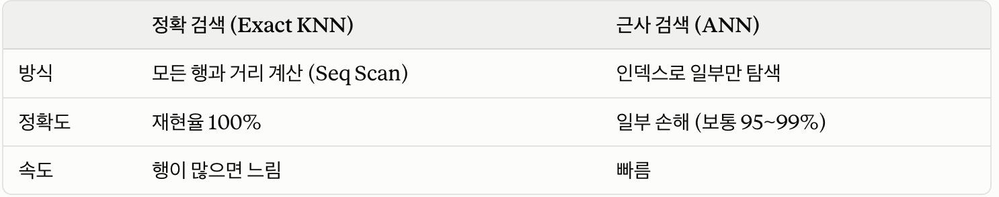
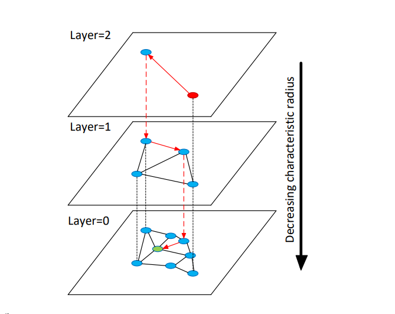

# 5주차 PG

## 벡터 검색

- **키워드 검색의 한계**
  - `pg_trgm`·`pg_bigm`·`tsvector`는 모두 **글자나 단어가 겹치는지**를 이용한 검색 방식
- **임베딩과 벡터**
  - **임베딩 모델**(OpenAI 등)이 텍스트·이미지를 숫자 배열로 바꿈
  - 이 배열이 **벡터**, 숫자 개수가 **차원**(보통 768~1536)입니다.
  - **뜻이 비슷하면 벡터 공간에서 가깝다**는 성질 덕분에, **거리가 가장 가까운 K개(KNN)** 를 찾으면 그게 의미 검색

**임베딩 모델 ex)**

- “고객이 결제 취소를 요청했어요.” → `[0.80, 0.20]`
- “환불 절차를 알려주세요.” → `[0.75, 0.25]`
- “내일 미팅은 3시에 시작합니다.” → `[0.10, 0.90]`



벡터 사이의 거리나 유사도를 계산함

이때 문장을 벡터로 표현하는 기준은, 임베딩 모델이 학습하면서 정한 “의미 좌표계”를 사용함

문장의 단어와 맥락을 함께 읽고, 벡터 **전체**로 의미를 표현

즉, 기준을 사람이 규칙을 직접 작성하는 게 아니라, **모델이 학습한 기준에 따라 모든 문장을 같은 좌표계에 배치함**



- **정확 검색 vs 근사 검색**
  - pgvector는 기본이 정확 검색이고, 인덱스를 만들면 근사 검색으로 변경됨
  - 즉, 인덱스를 추가하면 같은 쿼리의 결과가 달라질 수 있음



- **재현율(Recall)**: 정확 검색의 Top-K 중 근사 검색이 찾아낸 비율.
  - 벡터 인덱스 튜닝은 결국 "재현율 ↔ 속도" 사이의 trade-off 관계

### 사례

**① RAG 챗봇 (사내 문서 Q&A)**

사용자가 “출장비는 언제 정산돼?”라고 물으면 질문도 벡터로 바꿈 → 이 질문 벡터가 SQL의 $1임

```sql
SELECT c.content, c.metadata
FROM document_chunks c
WHERE EXISTS (
  SELECT 1
  FROM document_permissions p
  WHERE p.document_id = c.document_id
    AND p.user_id = $2
)
ORDER BY c.embedding <=> $1
LIMIT 10;
```

> < = > : 두 벡터가 얼마나 가까운지 계산하는 연산자
> WHERE절이 권한 검사하는 구간

`embedding <=> $1`은 **저장된 벡터와 질문 벡터 사이의 코사인 거리**를 계산하고, `ORDER BY ... LIMIT 10으으로`가까운 청크 10개를 골라서, 그 청크를 LLM에 전달해 답변을 만들음

질문에서 벡터로 변환한 임베딩 모델과 동일한걸로 c.embedding에 문서의 각 청크 본문을 아래처럼 벡터로 바꿔서 저장해둠

| 청크 본문 | 메타데이터(JSONB) | 벡터 |
|---|---|---|
| “출장비는 다음 달 급여일에 정산…” | `{"문서":"출장 규정","페이지":3}` | `[0.12, …]` |

**② 카테고리 필터가 있는 쇼핑몰 유사 상품 추천** — 전자제품 중 유사 상품 추천

의미상 비슷한 상품을 찾되, 결과를 전자제품으로 제한함

```sql
SELECT name
FROM products
WHERE category_id = 1  -- 전자제품
ORDER BY embedding <=> $1
LIMIT 10;
```

결과의 의미는 “전체 상품 중 비슷한 10개”가 아니라 “전자제품 중 비슷한 10개”

- **pgvector의 HNSW 반복 탐색(`hnsw.iterative_scan`)**: 벡터 인덱스에서 찾은 후보를 카테고리로 걸렀더니 결과가 부족한 경우, 인덱스를 더 탐색함
- **카테고리별 부분 인덱스**: 전자제품처럼 자주 검색하는 카테고리만 대상으로 별도 벡터 인덱스를 만들음
  - 단, 카테고리 종류가 적을 때 사용함
- **pgvectorscale의 라벨 필터**: 상품에 `labels SMALLINT[]`로 카테고리 번호를 저장하고, 벡터와 라벨을 함께 `diskann` 인덱스에 넣음
  - diskann 인덱스: 많은 벡터 중에서 가까운 벡터를 찾을 때 사용하는 지도, 비슷한 벡터들을 서로 연결한 지도를 만들어서서 검색할 때 해당 연결된 길을 통해 후보를 찾음
  -  검색할 때 `WHERE labels && ARRAY[1]`처럼 지정하면 인덱스가 그 라벨 조건을 직접 활용함

| 상품 | 벡터 (`embedding`) | 라벨 (`labels`) |
|---|---|---|
| 노트북 A | `[0.12, -0.03, …]` | `[1]` = 전자제품 |
| 태블릿 B | `[0.15, -0.01, …]` | `[1]` = 전자제품 |
| 책상 C | `[0.72, 0.41, …]` | `[2]` = 가구 |

---

## pgvector

PostgreSQL에 **벡터 타입 + 거리 연산자 + 벡터 인덱스**를 추가하는 익스텐션

벡터를 나머지 데이터와 함께 저장하면서 ACID, 시점 복구(PITR), JOIN 같은 Postgres 기능을 그대로 사용함

- 기본 사용법

```sql
CREATE EXTENSION vector;

CREATE TABLE items (id bigserial PRIMARY KEY, embedding vector(3));
INSERT INTO items (embedding) VALUES ('[1,2,3]'), ('[4,5,6]');

-- [3,1,2]와 가장 가까운 5개
SELECT * FROM items ORDER BY embedding <-> '[3,1,2]' LIMIT 5;
```

- 벡터 타입 (임베딩을 어떤 형태로 저장할지)

| 타입 | 쉽게 말하면 | 예시 |
|---|---|---|
| `vector` | 소수점 숫자를 일반적인 정밀도로 저장 | `[0.12, -0.03, 0.88]` |
| `halfvec` | 소수점 숫자를 조금 덜 정밀하게 저장해 용량을 줄임 (float2) | `[0.12, -0.03, 0.88]`처럼 보이지만 내부 표현이 더 간략함 |
| `bit` | 각 자리를 0 또는 1로만 저장 | `10110` |
| `sparsevec` | 0인 자리는 생략하고, 0이 아닌 자리만 저장 | `{1:1,3:2,5:3}/5` |

- halfvec 저장크기: 2×차원+8 bytes

```sql
[0.12, -0.03, 0.88]
  3차원(숫자 3개) × 2 bytes + 기본 정보 8 bytes = 14 bytes
```

> 2bytes: 벡터 안의 숫자 하나를 지정하는 크기

- sparsevec
  - 일반 벡터:       [1, 0, 2, 0, 3]
  - sparsevec 표현: {1:1, 3:2, 5:3}/5
  - 전체 **5차원**이고, 1번째 값은 1, 3번째 값은 2, 5번째 값은 3

- 거리 연산자

| 연산자 | 거리 종류 | 쉬운 설명 | 인덱스 opclass |
|---|---|---|---|
| `<->` | **L2 (유클리드)** | 직선 거리 | `vector_l2_ops` |
| `<#>` | **내적 (음수)** | 방향+크기 유사도 | `vector_ip_ops` |
| `<=>` | **코사인 거리** | 방향(각도)만 비교 | `vector_cosine_ops` |
| `<+>` | **L1 (맨해튼)** | 축 방향 거리 합 | `vector_l1_ops` |
| `<~>` | **해밍** | 다른 비트 개수 (bit 전용) | `bit_hamming_ops` |
| `<%>` | **자카드** | 집합 겹침 정도 (bit 전용) | `bit_jaccard_ops` |

- 인덱스 접근 방식 두 가지 (저장된 벡터 중 가까운 것을 어떻게 빨리 찾는지)

| 인덱스 AM | 찾는 방식 |
|---|---|
| **HNSW** | 비슷한 벡터끼리 이어 놓은 **연결 지도**를 따라가며 찾음 |
| **IVFFlat** | 벡터를 비슷한 것끼리 **여러 묶음**으로 나누고, 관련 있어 보이는 묶음부터 찾음 |

- **HNSW (Hierarchical Navigable Small World)** — 고차원 벡터 간의 유사도를 초고속으로 검색하기 위한 ANN(근사 최근접 이웃) 다층 그래프 기반 탐색 알고리즘
  - ANN: 근사 최근접 이웃 알고리즘
    - 정확도 100%를 포기하는 대신, 수학적으로 가까운 이웃을 매우 빠르게 근사한 값을 찾아내는 기법
    - 수많은 vector가 공간에 있을 때 공간을 랜덤 분할하고 특정 query vector가 들어오면 개별 vector가 아니라 해당 공간과의 근접도를 확인하는 방식으로 작동
    - 데이터를 미리 인덱싱(트리, 그래프, 해시 등)하여 탐색 범위를 구성할 수 있음
    - 하지만, 수백 차원 이상이 되면 이런 공간 분할 효율이 떨어지기에, 이를 극복하기 위해서 HNSW나 벡터 압축이 핵심이 됨
- **IVFFlat (Inverted File + Flat)** — k-means로 벡터를 `lists`개 군집으로 나누고, 검색 때 가까운 군집 `probes`개만 검색함

- HNSW는 공간을 쪼개는 것을 포기하고, 데이터를 연결하는 그래프 구조를 도입함

HNSW 알고리즘은 데이터를 저장할 때, 무조건 가까운 데이터(단거리 링크)만 연결하는 것이 아니라 알고리즘적으로 우연히 멀리 떨어진 데이터와 연결되는 장거리 링크를 몇 개씩 섞어서 그래프를 만들음

즉, 검색할 때 거쳐야 하는 이동 횟수(단계)가 더 작을수도 있기 때문



> 상위 계층: 줌아웃 (핵심 노드들만 보임)
> 하위 계층: 줌인(촘촘하게 노드들을 확인할 수 있음)

- **최상위 레이어 (Top Layer - 줌아웃 상태):** 가장 적은 수의 노드(데이터 포인트)만 존재하고, 이 노드들은 서로 멀리 떨어져 있고 이를 연결하는 링크의 길이도 길음
- **하위 레이어 (Bottom Layer - 줌인 상태):** 아래로 내려갈수록 노드의 밀도가 높아지며, 링크의 길이는 짧아짐
- **최하위 레이어 (Layer 0):** 시스템에 저장된 모든 데이터 포인트가 서로 연결되어 있음

- 탐색 프로세스
  - 최상위 레이어의 entry point에서 탐색 시작
  - 현재 레이어에서  탐색 벡터(쿼리)와 가장 가까운 인접 노드로 이동 (더 이상 가까운 노드가 없을 때까지 반복)
  - 최하위 레이어에 도달할 때까지 위 과정을 반복
  - 최종적으로 쿼리와 가장 유사한 k개의 벡터를 찾아냄

- **단점**
  - 메모리 오버헤드
    - 레이어별, 그래프 상태 관리를 메모리에서 유지해야하함
    - 새로운 데이터의 추가 또는 삭제 때마다 노드와 엣지 연결 관리를 다시 해줘야 함

- 양자화와 재순위
  - **양자화**: 벡터를 적은 비트로 압축.
    - **이진 양자화**는 양수→1, 그 외→0으로 32배 가까이 줄임
    - 원본은 숫자 하나가 float4라서 **32비트**
      - 4차원이면 128비트
    - 양자화하면 숫자 하나가 **1비트**라서 4비트가 되기에, **32배** 작아짐

    ```sql
    원본: [0.72, -0.14, 0.03, -0.91]
    이진: [   1,     0,    1,     0]
    ```

    > 정보 손실이 발생함

  - **재순위(Re-rank)**: 압축 벡터로 후보를 넉넉히(20개) 뽑고 원본으로 다시 정렬해 5개를 고름
    - 정보 손실이 발생하기에, 재순위가 필요함

  ```sql
  CREATE INDEX ON items USING hnsw ((binary_quantize(embedding)::bit(3)) bit_hamming_ops);

  SELECT * FROM (
    SELECT * FROM items
    ORDER BY binary_quantize(embedding)::bit(3) <~> binary_quantize('[1,-2,3]') LIMIT 20
  ) ORDER BY embedding <=> '[1,-2,3]' LIMIT 5;
  ```

  - `embedding`: 상품 등에 저장된 **원본 벡터**
  - `binary_quantize(embedding)`: 숫자를 양수는 `1`, 그 외는 `0`으로 변환
  - `::bit(3)`: 이 예시에서는 **3자리 이진 벡터**로 취급
  - `USING hnsw`: 가까운 벡터를 빨리 찾는 인덱스 방식
  - `bit_hamming_ops`: 이진 벡터끼리 **서로 다른 자리의 개수**로 비교

  `<~>`는 **해밍 거리**를 계산함

  - 질문 벡터 `[1,-2,3]`을 이진화한 `101`과, 각 항목의 이진 벡터를 비교해 가까워 보이는 **20개 가져옴**

  앞에서 뽑은 **20개 안에서,** 원본 `embedding`과 질문의 원본 벡터 사이의 코사인 거리(`<=>`)를 다시 계산 해 결과 가장 가까운 5개를 반환함

즉, 검색 속도와 정확도를 둘 다 챙기기 위해서 양자화와 re-rank가 필요함

| 단계 | 하는 일 | 필요한 이유 |
|---|---|---|
| **양자화** | 벡터를 작게 압축해 검색용 인덱스를 만듦 | 많은 후보를 빠르게 탐색하려고 |
| **재순위** | 후보 20개를 원본 벡터로 다시 비교해 최종 5개 선정 | 압축하면서 잃은 정보 때문에 생긴 순서 오류를 줄이려고 |

- 양자화의 강도

| 방식 | 숫자 하나당 | 크기 | 정보 손실 |
|---|---|---|---|
| `vector` (원본) | 32비트 | 1× | 없음 |
| `halfvec` | 16비트 | 1/2 | 아주 적음 |
| SBQ 2비트 (pgvectorscale) | 2비트 | 1/16 | 중간 |
| 이진 양자화 | 1비트 | 1/32 | 큼 |

- SBQ(Statistical Binary Quantization)는 pgvectorscale이 쓰는 압축 방식
  - 0을 기준으로 자르지 말고, 실제 데이터의 평균을 기준으로 자르는 방식

즉, 일반 이진 양자화의 문제를 해결할려 함

