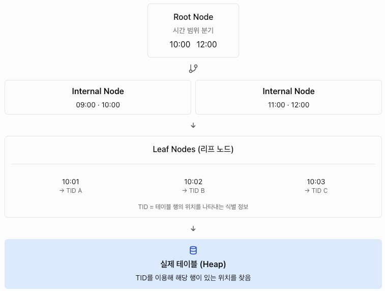
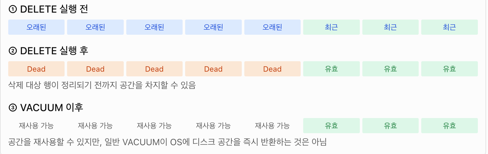
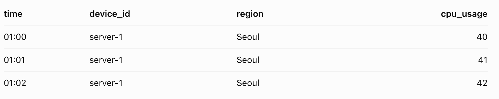
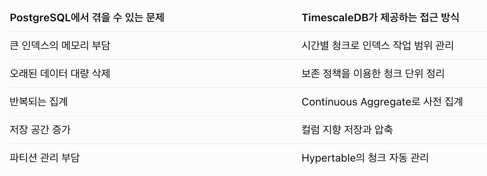
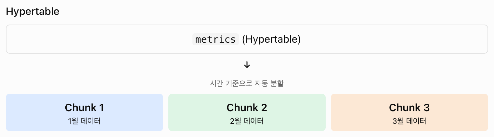
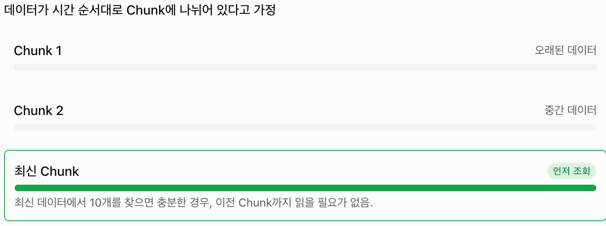
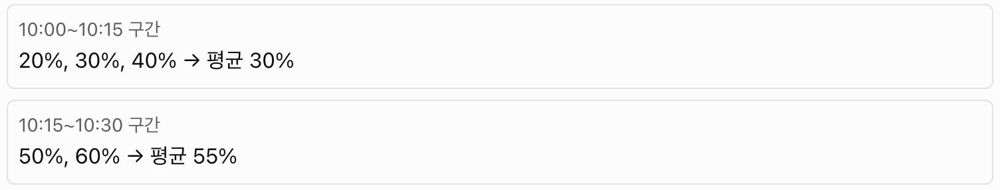

# 6주차 PG

## 시계열 데이터 (time-series)

- 같은 대상을 시간에 따라 반복해서 기록한 값의 흐름

| 구성 | 예시 | 역할 |
|---|---|---|
| **시간 (timestamp)** | `2026-10-14 01:00:00+09` | 정렬, 파티셔닝 기준 |
| **식별자 / 태그** | `device_id`, `region`, `host` | 무엇을 측정했나 |
| **값 (measurement)** | `temperature`, `cpu_usage` | 측정 결과<br>사용 예시) |

- IoT: 센서 온도, 습도 …
- 모니터링: 요청 지연 시간, 메모리

- 일반 데이터와의 차이점

| 특성 | 일반 OLTP 데이터 (주문, 회원) | 시계열 데이터 |
|---|---|---|
| 쓰기 패턴 | INSERT/UPDATE/DELETE  | **거의 INSERT만** (append-mostly) |
| 데이터 도착 순서 | 무작위 | **대체로 시간 순** (가끔 늦게 도착) |
| 쓰기 양 | 보통 | **매우 많음** (초당 수천~수백만 행) |
| 조회 패턴 | 특정 행 조회 (PK) | **시간 범위 + 집계** ("최근 1시간 평균") |
| 데이터 가치 | 오래돼도 유지 | **오래될수록 조회 빈도와 가치 하락** |
| 보관 정책 | 계속 보관 | 원본은 N일만, 이후 요약본 보관하거나 삭제 |

## PG 테이블에 시계열 데이터를 쌓으면 생기는 문제

1. **인덱스 비대화**: 테이블이 커지면 `time` 인덱스(B-tree)가 메모리(shared_buffers)에 다 안 올라감
   1. 일반적인 B-tree 인덱스는 시간순으로 정렬된 탐색 구조를 사용함
      1. 인덱스가 작으면, 자주 사용하는 인덱스 페이지가 메모리에 캐시됨
      2. 인덱스가 매우 크면, 디스크를 읽어야하기에 I/O 비용이 증가하게 됨

```sql
CREATE INDEX idx_metrics_time
ON metrics(time);
```

> metrics 테이블에 time 인덱스를 만들었을때



2. **오래된 데이터 삭제 비용**: `DELETE FROM metrics WHERE time < now() - interval '90 days'`는 수억 행을 하나씩 지우면서 dead tuple을 만들기에 VACUUM 부담이 발생함



3. **반복되는 집계 비용**: 대시보드가 새로고침될 때마다 원본 대량 데이터를 다시 스캔해서 집계함
   1. 시계열 데이터를 저장하는 이유 중 하나는 시간별 평균, 최댓값, 합계 등을 확인하기 위해서임
   2. 즉, 미리 계산하면서 갱신하는 방향으로 사용함

4. **저장 공간**:  PG는 기본적으로 행 단위로 데이터를 저장함



> PG 저장방식

중복되는 칼럼 값이 계속 생김

- 시계열에 특화된 압축 사용
  - 시계열 데이터는 비슷한 값이나 규칙적인 시간 간격이 반복되는 경우가 많음
    - 시간 간격이 규칙적이면 시간 정보 압축
    - 값이 천천히 변하면 차이값 기반 압축
    - 같은 태그 값이 반복되면 반복 정보를 줄이는 방식
  - 즉, 열 압축과 시계열 특화 압축(차이값 기반 등..) 이런 조합들을 함께 사용함
  - compression이라고도 부르기도 하고, 최근에는 hypercore 또는 행-열 하이브리드 스토리지 엔진이라고 부름

그렇기에 TimeScaleDB는 PG기반으로 한 시계열 처리를 강화한 제품

- 기존 PG의 SQL과 트랜잭션 기능을 활용하면서 시계열 데이터 관리 기능을 추가할 수 있음



> Continuous Aggregate: 시계열 데이터를 미리 집계해 두고 빠르게 조회하는 기능
> Hypertable: 시계열 데이터를 효율적으로 저장하기 위한 테이블 구조



> 설정된 시간 간격에 따라 청크를 해서 저장함
> hypertable은 논리적인 테이블이고, 실제 데이터 저장은 청크를 통해 일반 PG 테이블로 저장됨

- chunk마다 check 제약과 자체 인덱스가 있음
  - **check 제약**: 데이터가 특정 조건을 만족하는지 확인하는 규칙

- chunk 간격 설계
  - `chunk_time_interval` 기본값은 **7일**
  - 최근 활성 chunk들의 인덱스 전체 크기가 메모리의 약 25% 안에 들어갈 정도
    - 너무 작으면 chunk수가 많아지고, 너무 크면 메모리를 넘어감

- `_timescaledb_catalog` 스키마
  - TimescaleDB가 메타데이터를 관리하는 공간
    - 어떤 Hypertable이 존재하는지
    - Hypertable이 어떤 Chunk들로 나뉘어 있는지
    - 각 Chunk의 시간 범위가 어떻게 되는지
    - Chunk와 관련된 내부 관리 정보

**쿼리 최적화**

- 조건 밖의 chunk는 스캔 범위에서 제외

```sql
EXPLAIN SELECT * FROM metrics WHERE time > now() - interval '1 day';
```

- ChunkAppend 노드
  - 필요한 chunk만 읽는 방식



Explain 실행 계획에서 확인하면

```bash
Limit
  -> Custom Scan (ChunkAppend)
       Order: time DESC
       -> Index Scan ...
       -> Index Scan ...
```

- `Limit`: 결과를 10개까지만 반환함
- `ChunkAppend`: 여러 Chunk에서 결과를 모으는 TimescaleDB 전용 실행 노드
- `Index Scan`: 해당 Chunk의 인덱스를 활용해 데이터를 찾는 작업

- 시간을 일정한 구간으로 묶기: time_bucket()

```sql
SELECT time_bucket('15 minutes', time) AS bucket,
       device_id,
       avg(temperature),
       first(temperature, time),   -- 구간 첫 값
       last(temperature, time)     -- 구간 마지막 값
FROM metrics
WHERE time > now() - interval '1 day'
GROUP BY bucket, device_id
ORDER BY bucket;
```



- Continuous Aggregate가 필요한 이유

```sql
-- 자동 갱신 정책
SELECT add_continuous_aggregate_policy('metrics_hourly',
  start_offset      => INTERVAL '3 hours',
  end_offset        => INTERVAL '1 hour',
  schedule_interval => INTERVAL '30 minutes');
```

|  | PG MATERIALIZED VIEW | Continuous Aggregate |
|---|---|---|
| 갱신 방식 | `REFRESH` 시 **전체 재계산** | **변경된 구간만** 재계산 |
| 자동 갱신 | 없음 (pg_cron 등 필요) | 정책으로 자동 |
| 최신 데이터 | 마지막 REFRESH 시점까지 | 실시간 집계 옵션으로 최신 원본 합산 가능 |

cf)

| 구분 | 일반 View | Materialized View |
|---|---|---|
| 데이터 저장 | 조회 결과를 별도로 저장하지 않음 | 조회 결과를 물리적으로 저장 |
| 조회할 때 | 기반 테이블을 조회하는 쿼리 실행 | 저장된 결과를 읽음 |
| 최신 데이터 | 기반 테이블의 최신 데이터 반영 | 마지막 갱신 시점의 결과 |
| 성능 | 복잡한 쿼리는 느릴 수 있음 | 미리 계산한 결과라 빠를 수 있음 |

