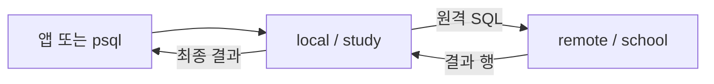

# 01. DB 두 개를 함께 읽는다는 것

## 이 장에서 얻을 것

SQL을 처음 보더라도 “어느 서버가 어떤 데이터를 가지고 있고 누가 누구에게 요청하는가”를 설명할 수 있게 되는 것이 목표다. 먼저 책 목록과 대출 기록으로 시작한다. 연결 설정과 성능 튜닝은 다음 장부터 배운다.

## 1. 테이블과 SQL을 먼저 이해한다

테이블은 이름이 있는 표다. books 테이블의 한 행은 책 한 권이며 id, title, category는 열이다. id는 책을 구별하는 번호다. 데이터베이스는 이러한 표와 사용자 권한 등을 관리하는 공간이고, PostgreSQL 서버는 요청을 받아 표를 읽거나 수정하는 프로그램이다.

```sql
SELECT id, title
FROM books
WHERE category = 'database'
ORDER BY id
LIMIT 3;
```

이 요청은 “books에서 database 분류에 속하는 책을 골라 번호순으로 세 권의 번호와 제목을 돌려달라”는 뜻이다. SELECT는 가져올 열, FROM은 대상 표, WHERE는 조건이다. ORDER BY가 없으면 특정 순서를 보장하지 않는다. LIMIT은 결과 개수의 상한이지, 항상 그 수만큼의 데이터만 읽는다는 약속이 아니다.

## 2. 같은 서버와 다른 DB는 다르다

학교 A의 서버에 study DB가 있고 학교 B의 서버에 school DB가 있다고 하자. study에 접속해서 books를 조회하면 기본적으로 study 안에서 그 이름을 찾는다. 다른 DB의 표를 `school.public.books`라고 적기만 해서 조회할 수 있는 것은 아니다. PostgreSQL의 일반 연결은 하나의 DB를 선택한다.

같은 PostgreSQL 인스턴스 안의 별도 DB도 별도 연결이 필요하다. 반면 같은 DB 안의 서로 다른 스키마는 `public.books`, `library.books`처럼 이름을 붙여 함께 조회할 수 있다. 스키마는 DB 안에서 객체를 묶는 이름 공간이다.

| 용어 | 학교 비유 | 실습에서의 이름 |
| --- | --- | --- |
| 서버 | 표를 보관하고 요청에 답하는 학교 사무실 | local, remote 컨테이너 |
| DB | 사무실 안의 장부 묶음 | study, school |
| 스키마 | 장부를 나눈 분류함 | public, remote_school |
| 테이블 | 책 목록 표 하나 | books |
| 연결 | SQL을 주고받는 통신 창구 | psql 연결, FDW 연결 |

## 3. 두 표를 함께 읽는 세 가지 방법

첫 번째는 앱이 A와 B에 각각 접속하는 것이다. 앱이 책 목록과 대출 기록을 받아 책 번호로 합친다. 두 서버의 인증 정보와 오류, 결과를 합칠 메모리는 앱이 관리한다.

두 번째는 B의 데이터를 A로 복사하는 것이다. A에서는 로컬 표끼리 조회하므로 B가 잠시 응답하지 않아도 복사본을 읽는다. 대신 복사 주기만큼 오래된 결과를 볼 수 있고, 복사 실패·중복·삭제 반영을 관리해야 한다.

세 번째는 A에 B의 표를 가리키는 안내판을 두는 것이다. 앱은 A에 SQL 하나를 보내고 A가 B에 요청한다. postgres_fdw가 맡는 일이 세 번째다. SQL을 짧게 쓰게 됐다고 B의 일과 네트워크 비용이 사라진 것은 아니다.



## 4. 지연·부하·정확성은 서로 다른 질문이다

지연은 요청 하나가 끝날 때까지 걸린 시간이다. 부하는 동시에 요청이 몰릴 때 서버가 감당해야 하는 작업량이다. 정확성은 결과가 어떤 시점의 데이터인지, 쓰기가 실패했을 때 어디까지 반영됐는지에 관한 질문이다.

예를 들어 책 목록 한 번을 20ms에 읽는다고 가정해도 학생 천 명이 동시에 읽을 때 모두 20ms에 끝난다고 말할 수 없다. 또 빠르게 결과가 나왔더라도 한 트랜잭션에서 유지하는 과거 스냅샷일 수 있다. 이 숫자는 설명용 가정이며 실측이 아니다.

## 5. 먼저 정답을 설명해 본다

복습 질문: A에 foreign table을 만들면 B의 데이터가 A 디스크로 전부 복사될까?

답: 아니다. foreign table은 연결 대상과 열 정의를 나타내며 조회 시 B에 요청한다. 로컬 복사본이 필요하면 별도 테이블이나 구체화 뷰를 만들어야 한다.

복습 질문: 앱이 B에 접속할 수 있으면 A의 FDW도 접속할 수 있을까?

답: 단정할 수 없다. 앱→B와 A 서버→B의 네트워크 출발점과 인증이 다르다. 다음 장에서 요청 경로를 더 구체적으로 만든다.

## 참고와 다음 장

[PostgreSQL foreign data 개념](https://www.postgresql.org/docs/18/ddl-foreign-data.html) · [스키마](https://www.postgresql.org/docs/18/ddl-schemas.html)

다음: [02. FDW의 네 가지 객체](02-fdw-and-four-objects.md). 표를 가리키는 안내판을 PostgreSQL 객체로 바꿔 본다.
