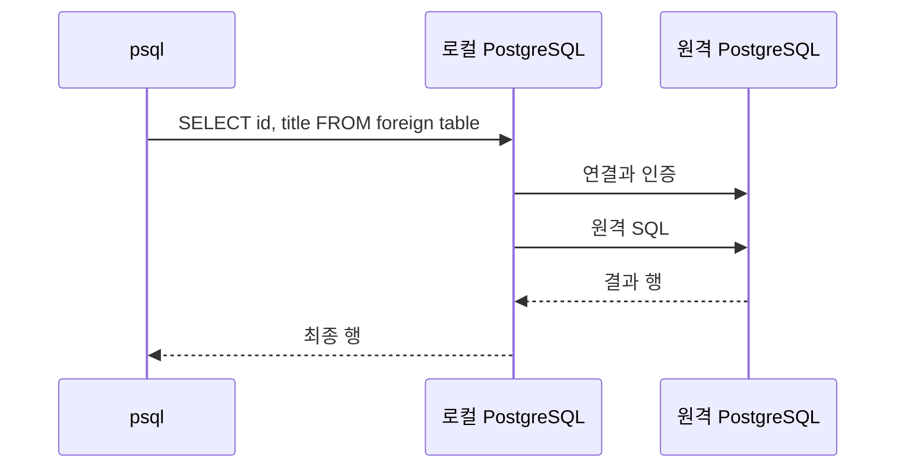

# 03. 연결·권한·첫 조회

## 이 장에서 얻을 것

새 환경에서 원격 데이터와 최소 읽기 계정을 준비하고 로컬에서 조회한다. 오류가 나면 네트워크·로그인·객체 권한을 나누어 확인할 수 있게 된다. 실습 명령은 [Lab 01](../../labs/01-connect-and-metadata/HANDS-ON.md)에서 그대로 실행할 수 있다.

## 1. 원격 준비와 로컬 준비를 나눈다

remote의 school DB에는 실제 books 표가 있어야 한다. fdw_reader 로그인 계정에는 DB CONNECT, public 스키마 USAGE, books SELECT가 필요하다. 여기서 CONNECT는 DB 진입, USAGE는 이름을 사용할 권한, SELECT는 행을 읽을 권한이다.

```sql
-- 원격 관리자 세션: 공유 환경 setup.sql에 들어 있는 내용의 예시
GRANT CONNECT ON DATABASE school TO fdw_reader;
GRANT USAGE ON SCHEMA public TO fdw_reader;
GRANT SELECT ON public.books TO fdw_reader;
```

로컬 study DB에서는 확장을 활성화하고 server, mapping, foreign table을 등록한다. 실습 runner가 설정을 준비하므로 수동 SQL을 중복 실행하지 않고 HANDS-ON의 관찰 쿼리를 진행한다. postgres_fdw 자체는 shared_preload_libraries나 재시작을 요구하지 않는다. 관측용 pg_stat_statements의 preload 설정은 별도다.

## 2. 첫 요청은 세 군데를 지난다



첫 요청은 연결·인증 비용을 포함할 수 있다. 같은 로컬 세션의 다음 요청은 원격 연결을 재사용할 수 있으므로 “첫 요청만 느리다”는 현상을 별도로 측정한다. psql을 매번 새로 켜면 동일한 세션의 재사용을 측정하는 것이 아니다.

## 3. IMPORT FOREIGN SCHEMA의 의미

```sql
IMPORT FOREIGN SCHEMA public LIMIT TO (books, publishers)
FROM SERVER school_remote INTO remote_school;
```

원격 public의 지정한 표 정의를 읽어 로컬 remote_school에 foreign table을 만든다. books의 10만 행을 로컬 테이블로 복사하지 않는다. 대상 로컬 스키마는 먼저 있어야 하고 같은 이름의 객체가 이미 있으면 충돌할 수 있다.

원격에 새 열이 생기거나 열 타입이 바뀌어도 기존 foreign table이 자동 갱신되지는 않는다. 배포 때 원격 스키마 변경과 로컬 정의 변경을 함께 관리한다. “IMPORT 했으니 계속 같을 것”이라고 가정하지 않는다.

## 4. 오류를 계층으로 읽는다

| 현상 | 먼저 확인할 것 | 판단 범위 |
| --- | --- | --- |
| host를 찾지 못함 | 로컬 DB 서버에서 DNS·Compose 네트워크 | 앱의 DNS 성공과는 별개 |
| connection refused / timeout | 목적지 주소·포트·방화벽·listen 설정 | 아직 SQL SELECT 권한 단계가 아닐 수 있음 |
| password authentication failed | mapping의 계정·인증·pg_hba.conf | 인증은 통과해야 함 |
| permission denied for table | 원격 SELECT 및 로컬 객체 권한 | 서버 로그의 DB·사용자 확인 |
| relation does not exist | 원격 schema_name·table_name, 로컬 정의 | 접속 성공과 표 존재는 별개 |

운영에서는 TLS의 암호화뿐 아니라 CA·호스트 검증을 구성한다. libpq의 sslmode=verify-full과 sslrootcert 경로를 검토하며 인증서 파일을 읽는 주체는 PostgreSQL 서버 프로세스다. 실습 환경은 외부 포트를 공개하지 않는 폐기 가능한 내부 네트워크다.

## 5. 읽기 전용 권한이 실제로 작동하는지

Lab 01은 fdw_reader로 UPDATE를 시도하고 권한 오류가 나는지 확인한다. 성공해서는 안 되는 동작의 실패도 검증 결과다. 비밀번호와 계정 이름을 설정했다는 사실만으로 최소 권한을 확인한 것은 아니다.

로컬 앱 역할에 필요한 권한을 부여할 때 mapping도 그 역할에 맞춰야 한다. 관리자가 조회에 성공했다고 일반 앱 역할의 권한을 검증한 것은 아니다.

## 6. 복습

질문: 노트북의 브라우저에서 원격 DB 주소를 확인했는데 FDW 연결은 실패한다. 모순일까?

답: 아니다. FDW는 로컬 PostgreSQL 서버에서 연결을 시작한다. 그 서버가 사용하는 DNS·경로·인증을 확인해야 한다.

질문: IMPORT 후 원격 데이터가 수정되면 새로 IMPORT해야 하나?

답: 행 변경은 조회 시 읽는다. 표 정의가 바뀐 경우에는 별도 정의 점검이 필요하다. 행 변경과 스키마 변경을 구분한다.

## 참고와 다음 장

[IMPORT FOREIGN SCHEMA](https://www.postgresql.org/docs/18/sql-importforeignschema.html) · [libpq 연결 옵션](https://www.postgresql.org/docs/18/libpq-connect.html)

다음: [04. SELECT와 JOIN의 데이터 흐름](04-select-and-joins.md). 요청 하나가 어떤 중간 결과를 만드는지 배운다.
