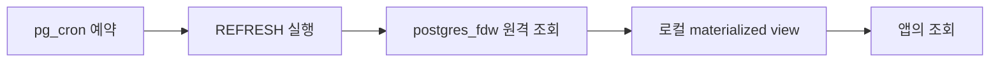

# pg_cron · 원격 의존성을 갱신 작업으로 옮기기

## 처음 이해하기: 매번 전화 대신 시간표에 맞춘 복사
현재 원격 값을 매 요청마다 읽는 대신 정해진 시간에 로컬 집계를 갱신할 수 있습니다. pg_cron은 SQL 실행 시간표를 관리하며, materialized view는 결과를 저장하고 postgres_fdw는 갱신 때 원격을 읽습니다. 각각 별도의 역할입니다.



## 기본 갱신 예제
```sql
CREATE MATERIALIZED VIEW public.book_counts AS
SELECT category,count(*) AS books
FROM remote_school.books GROUP BY category;
CREATE UNIQUE INDEX book_counts_category ON public.book_counts(category);
REFRESH MATERIALIZED VIEW CONCURRENTLY public.book_counts;
```
category가 그룹 키인 이 예제에서는 결과에 하나의 category당 한 행이 나옵니다. 일반 REFRESH와 CONCURRENTLY의 잠금·비용을 비교하며, CONCURRENTLY의 적합한 UNIQUE 인덱스·채워진 view 등의 전제를 확인합니다. 자동 증분 갱신이 아닙니다. [REFRESH 조건](https://www.postgresql.org/docs/18/sql-refreshmaterializedview.html)

## 예약 예제의 전제
```sql
SELECT cron.schedule('refresh-book-counts','*/10 * * * *',
 'REFRESH MATERIALIZED VIEW CONCURRENTLY public.book_counts');
SELECT jobid,status,start_time,end_time,return_message
FROM cron.job_run_details
ORDER BY start_time DESC LIMIT 10;
```
10분 간격 예시이며 운영 추천 주기가 아닙니다. pg_cron의 preload·설치·인증·대상 DB·실행 역할·timezone을 먼저 준비합니다. 실행 역할에 view 갱신 권한과 필요한 FDW mapping이 있어야 합니다. 이 코드는 pg_cron을 설치하지 않은 Week 07 공유 환경에서 그대로 실행할 수 없습니다.

## 심화: 느린 갱신과 작업 대기
pg_cron은 같은 job의 실행을 하나씩 처리하며 다음 실행이 오면 대기시킬 수 있습니다. 다른 job으로 같은 view 갱신을 중복 예약하는 경우는 별도로 관리합니다. pg_cron 실행 예산, FDW가 생성하는 원격 연결, 원격 업무 부하를 함께 계산합니다. cron 작업 성공이 데이터 최신성을 자동 보증하지는 않습니다. [pg_cron 공식 저장소](https://github.com/citusdata/pg_cron)
job_run_details의 성공 여부와 실제 마지막 성공 갱신 시각, 원격 데이터 기준 시각을 구분합니다. 허용 지연을 넘으면 이전 값 표시·오류 처리·갱신 재시도 중 업무 정책을 선택합니다. 실패 시 무한 재시도를 겹치게 만드는 것보다 재시도 간격·최대 횟수·수동 개입 조건을 정합니다.

## 갱신 비용과 정합성
원격 집계 pushdown, 반환량, 전체 REFRESH 시간과 동시 읽기 영향을 측정합니다. 표 크기가 커지면 COPY·staging·논리 복제 같은 대안을 비교할 수 있지만 논리 복제는 PostgreSQL 기능이며 이 문서의 관련 확장 목록과 같은 분류는 아닙니다. 삭제·지연 변경·watermark의 누락 처리는 별도 설계가 필요합니다.

## 실습과 검증 범위
Week 03의 pg_cron 자료에는 실행·큐·관측 실습이 있고, Week 07에는 [캐시와 이관 주의사항](../blog-review.md)이 있습니다. FDW와 pg_cron을 합친 자동 갱신의 성능·장애 검증은 아직 수행하지 않았습니다. 위 예제는 전제 조건을 갖춘 추가 수동 Lab입니다.
복습: 예약을 10분마다 실행했지만 작업이 15분 걸린다면 데이터 신선도와 큐를 어떻게 확인할까요? 원격 장애 중 이전 데이터를 제공하는 정책을 설명해 봅니다.
