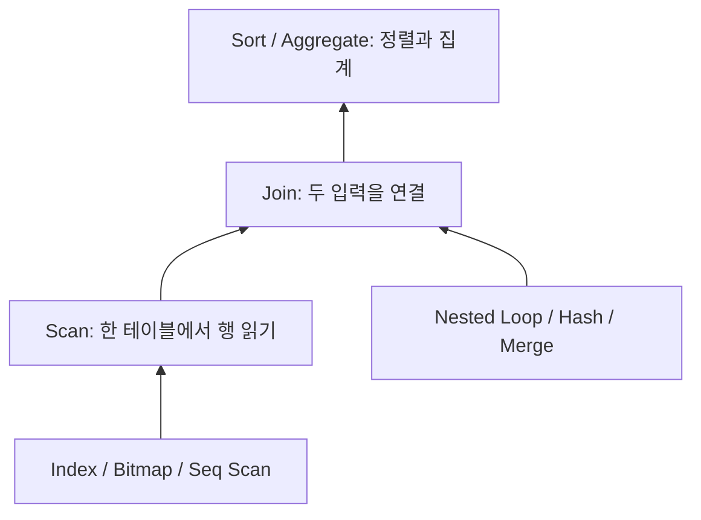

# 번외 · PostgreSQL JOIN 학습 지도

## 두 명단을 합치는 일에서 시작하기
학생 명단에는 학생 번호와 이름이 있고, 주문 명단에는 학생 번호와 구매 내역이 있다고 해 봅시다. JOIN은 같은 학생 번호를 가진 행을 찾아 하나의 결과로 연결하는 작업입니다. 같은 결과를 만들더라도 하나씩 찾아갈지, 번호별 상자를 만들지, 번호순으로 나란히 읽을지에 따라 필요한 시간이 달라집니다.
이 번외는 특정 익스텐션이 아니라 PostgreSQL 자체를 공부합니다. Week 07과 독립적으로 읽을 수 있고, FDW의 로컬 JOIN과 원격 JOIN을 이해하는 기초가 됩니다. 기준은 PostgreSQL 18입니다.

## 학습 순서
| 단계 | 페이지 | 읽고 답할 질문 |
| --- | --- | --- |
| 기본 | [JOIN의 의미와 결과](semantics.md) | LEFT JOIN과 Hash Join은 왜 다른 분류인가? |
| 기본 | [Nested Loop](nested-loop.md) | 바깥 행이 5개일 때 인덱스 탐색이 왜 유리한가? |
| 기본 | [Hash Join](hash.md) | 번호별 상자를 만드는 비용은 언제 회수되는가? |
| 기본 | [Merge Join](merge.md) | 정렬 비용을 이미 지불했을 때 무엇이 달라지는가? |
| 구분 | [Bitmap은 JOIN인가?](bitmap.md) | 한 테이블의 행 위치를 합치는 것과 두 테이블을 연결하는 것은 어떻게 다른가? |
| 심화 | [계획·메모리·동시 부하](planning.md) | 예상 행 수가 틀리면 어떤 비용이 증폭되는가? |
| 실습 | [실행 계획 Lab](labs.md) | 같은 결과를 세 방법으로 얻고 실제 노드를 확인할 수 있는가? |

## 실행 계획의 층

Bitmap과 Hash Join은 서로 다른 층에 있으므로 한 실행 계획에 함께 나타날 수 있습니다.

## 세 가지 방식의 비교
| 방식 | 준비와 반복 | 먼저 의심할 비용 | 유리할 수 있는 상황 |
| --- | --- | --- | --- |
| Nested Loop | 바깥 행마다 안쪽 실행 | loops × 안쪽 탐색 | 작은 바깥 결과 + 안쪽 인덱스 |
| Hash Join | 한 입력의 해시 테이블 구축 후 다른 입력 조회 | 메모리·배치·임시 I/O | 많은 행의 동등 조건 JOIN |
| Merge Join | JOIN 키 순서로 두 입력 전진 | Sort·중복 키 처리 | 이미 정렬된 큰 입력 |

어떤 방식도 항상 빠르지 않습니다. 입력 건수, 중복, 행 폭, 인덱스, 정렬, 메모리와 필요한 출력 개수를 함께 봅니다. SQL에 INNER JOIN을 썼다고 Hash Join을 지정한 것은 아닙니다.

## FDW로 이어 읽기
로컬 데이터의 JOIN을 이해한 다음 [FDW SELECT와 JOIN](/postgres-fdw/select-joins), [FDW 비용·통계·JOIN](/postgres-fdw/costs)을 읽습니다. 다음 질문은 “무슨 알고리즘인가?”와 함께 “어느 서버에서 실행하고 네트워크로 몇 행을 옮기는가?”입니다. 원격 JOIN이 pushdown되면 로컬 계획에서는 Foreign Scan으로 보일 수 있어 원격 계획도 별도로 확인해야 합니다.

## 공식 근거
[PostgreSQL 실행 계획 문서](https://www.postgresql.org/docs/18/using-explain.html)와 각 장의 추가 근거를 기준으로 구성합니다. Lab의 관측 결과는 이 저장소의 작은 단일 세션 환경이며 운영 성능의 우열을 뜻하지 않습니다.
